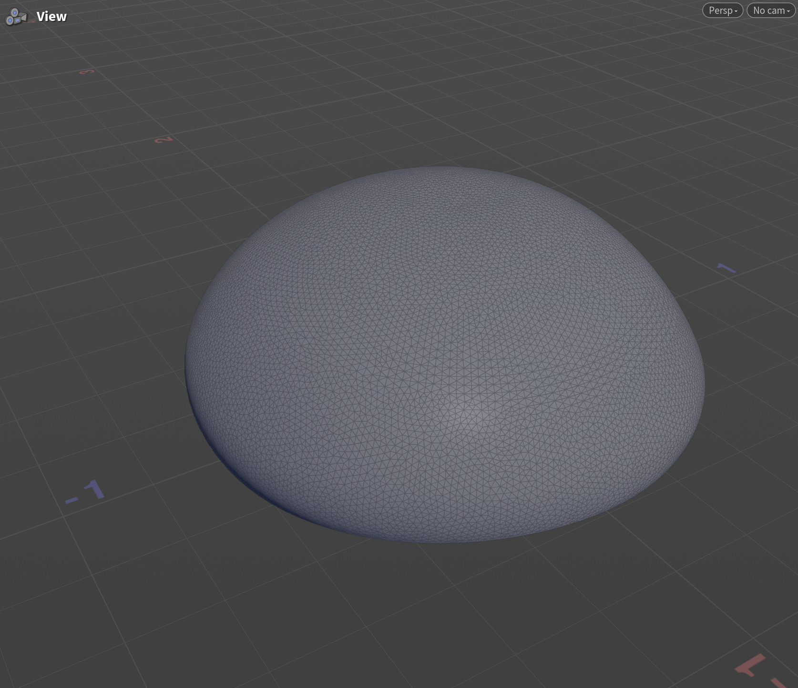
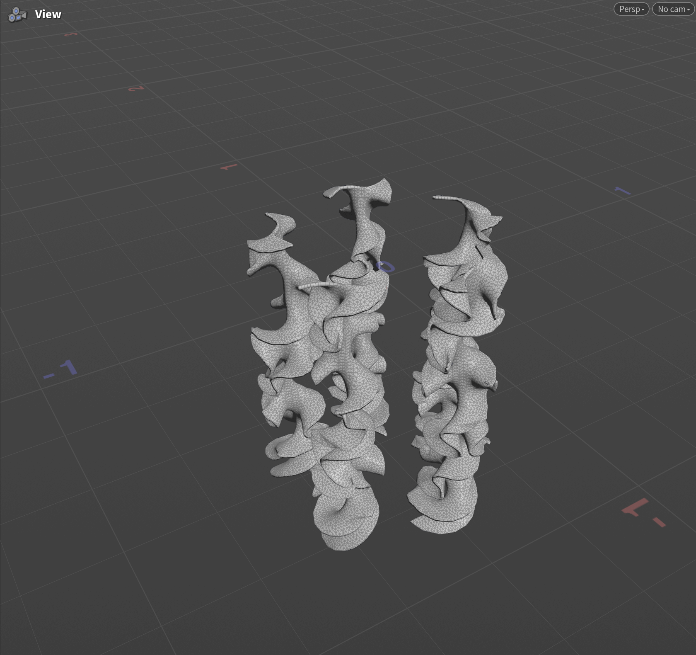
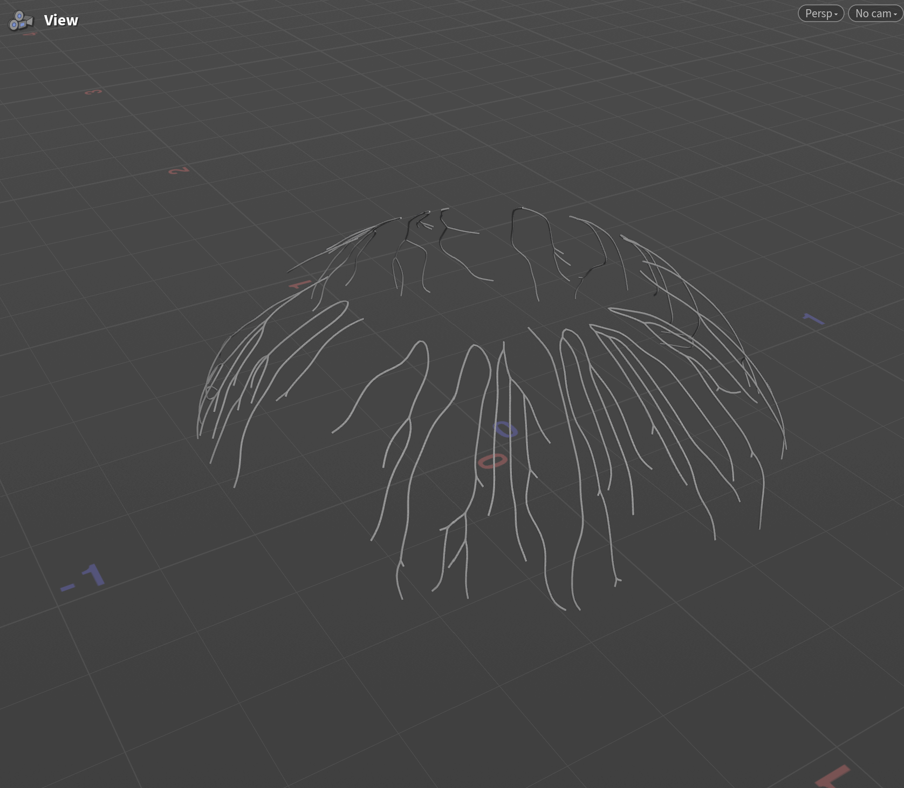
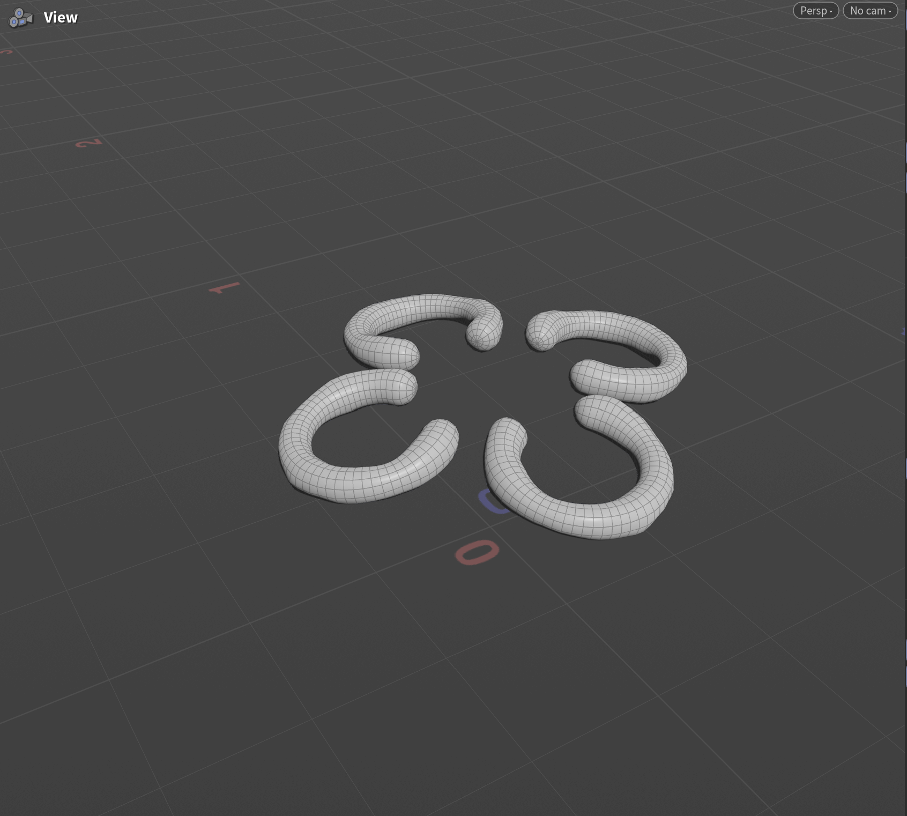
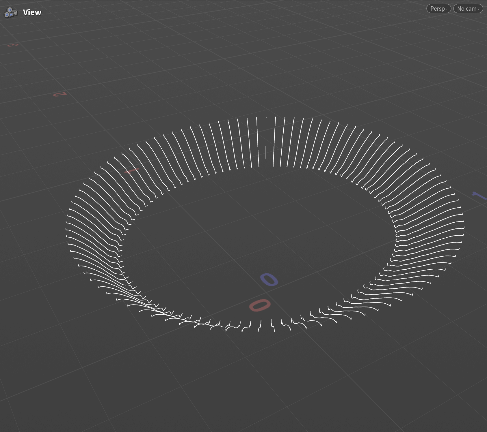

# Procedural Jellyfish - Ziqiu Wang

In this project, I created an animated jellyfish in Houdini that consists of various parts: the bell, oral arms, veins, organs, and tentacles.

<video src="Jellyfish.mp4" controls width="640" height="360">
  Jellyfish video
</video>

## Bell
The bell was created by revolving a dynamically bent line with added noise to further deform the surface and simulate the underwater effect. 

## Arms
The arms were created by deforming a grid mesh with a sin wave and a noise function, and then twisting the mesh and using a vellum constraint set to cloth to allow bending.

## Veins
The veins were created by first randomly selecting start points near the top of the bell and end points in the bottom half, and then using the Find Shortest Path node on these points. Then, Fuse, Smooth, and Resample nodes were used to make the veins look more natural and organic. Instead of a Sweep node, I used a Polywire node to add thickness to the veins since it made the veins look more smooth.

## Organs
The organs were created by sweeping an open arc circle and adding noise to the resulting mesh using a Mountain node. The mesh was then copied 3 times with a rotation of 90 degrees.

## Tentacles

The tentacles were created by pinning a line to numerous points on the bottom edge of the bell and using a hair vellum constraint to simulate the softness.

